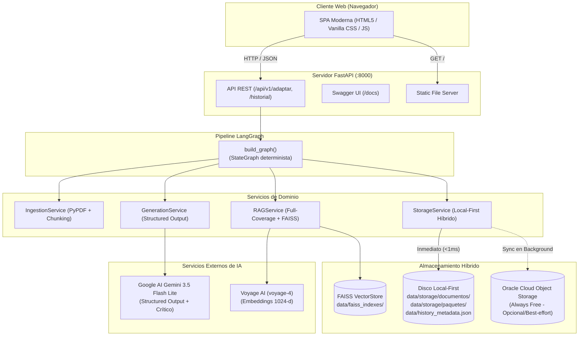
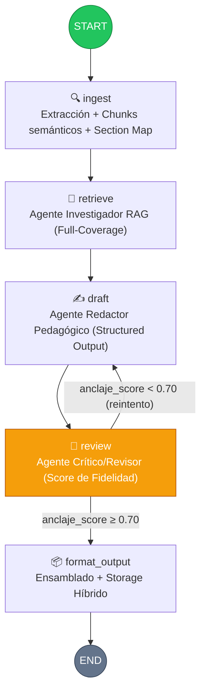

# 🧠 NuevaMente — Plataforma de Adaptación Pedagógica de Documentación Técnica

[](https://nuevamente.onrender.com)
[](https://www.python.org/)
[](https://fastapi.tiangolo.com/)
[](https://langchain-ai.github.io/langgraph/)
[](https://ai.google.dev/)
[-purple.svg)](https://www.voyageai.com/)
[-green.svg)](https://github.com/facebookresearch/faiss)
[](https://www.oracle.com/cloud/)
[](https://pytest.org/)
[](LICENSE)

> 🌐 **Demo en vivo disponible en:** [https://nuevamente.onrender.com](https://nuevamente.onrender.com)

**NuevaMente** es una plataforma de aprendizaje diseñada para transformar documentación técnica compleja (manuales en **PDF**, guías en **Markdown** o código/tutoriales en **Texto plano**) en paquetes pedagógicos estructurados y altamente personalizados.

A diferencia de un chatbot RAG convencional de preguntas y respuestas, **NuevaMente no responde preguntas puntuales**: ingesta el documento fuente completo y sintetiza un producto de aprendizaje nuevo, rigurosamente estructurado bajo modelos **Pydantic**, calibrado según el nivel de experiencia del destinatario, el formato pedagógico de estudio y un nicho sectorial opcional, garantizando siempre una alta fidelidad al texto original (`anclaje_fuente_score >= 0.70`).

---

## 📌 Tabla de Contenidos

- [Propuesta de Valor & Diferencial](#-propuesta-de-valor--diferencial)
- [Parámetros de Adaptación & Formatos](#-parámetros-de-adaptación--formatos)
- [Arquitectura del Sistema](#-arquitectura-del-sistema)
  - [Diagrama de Componentes](#diagrama-de-componentes)
  - [Almacenamiento Híbrido Local-First & OCI](#almacenamiento-híbrido-local-first--oci)
- [Pipeline RAG Multi-Agente (LangGraph)](#-pipeline-rag-multi-agente-langgraph)
  - [Grafo de Procesamiento](#grafo-de-procesamiento)
  - [Estrategia Full-Coverage Retrieval](#estrategia-full-coverage-retrieval)
  - [Structured Output y Agente Crítico](#structured-output-y-agente-crítico)
- [Experiencia de Usuario e Interfaz Web](#-experiencia-de-usuario-e-interfaz-web)
- [Instalación y Puesta en Marcha](#-instalación-y-puesta-en-marcha)
  - [Requisitos Previos](#requisitos-previos)
  - [Paso 1: Clonar el Repositorio](#paso-1-clonar-el-repositorio)
  - [Paso 2: Instalación de Dependencias](#paso-2-instalación-de-dependencias)
  - [Paso 3: Variables de Entorno](#paso-3-variables-de-entorno)
  - [Paso 4: Iniciar el Servidor](#paso-4-iniciar-el-servidor)
- [API REST y Documentación Interactiva](#-api-rest-y-documentación-interactiva)
- [Escenarios de Demostración Reproducibles](#-escenarios-de-demostración-reproducibles)
  - [Ejecución Rápida](#ejecución-rápida)
  - [Tabla Resumen de Evidencias](#tabla-resumen-de-evidencias)
- [Estructura del Proyecto](#-estructura-del-proyecto)
- [Métricas de Calidad y Criterios del Hackathon](#-métricas-de-calidad-y-criterios-del-hackathon)
- [Suite de Pruebas](#-suite-de-pruebas)
- [Licencia](#-licencia)

---

## 💡 Propuesta de Valor & Diferencial

En el aprendizaje de tecnologías complejas, los profesionales enfrentan documentación heterogénea, densa y poco adaptada a su contexto. Los asistentes conversacionales tradicionales sufren de fragmentación, pérdida de contexto global y riesgo de alucinación.

| Dimensión | Chatbot RAG Tradicional | NuevaMente |
|---|---|---|
| **Punto de Entrada** | Pregunta breve del usuario | Documento técnico completo (PDF, MD, TXT) |
| **Objetivo** | Responder una duda puntual | Transformar y sintetizar un recurso educativo integral |
| **Cobertura** | Recupera solo fragmentos afines a la pregunta | Estrategia *Full-Coverage* que cubre todas las secciones |
| **Estructura** | Texto libre en lenguaje natural | Objetos fuertemente tipados con esquemas Pydantic v2 |
| **Control de Calidad** | Sin validación de fidelidad automática | Agente Crítico/Revisor con bucle de corrección autónomo |
| **Personalización** | Prompt engineering manual | Matriz formal: Perfil $\times$ Formato $\times$ Nicho |

---

## 🎯 Parámetros de Adaptación & Formatos

NuevaMente modula la transformación técnica a través de tres dimensiones ortogonales:

### 1. Documentos Soportados
* **PDF:** Extracción profunda de texto mediante PyPDF (ej. manuales de arquitectura y redes de 15+ páginas).
* **Markdown (.md):** Preservación de jerarquías de encabezados y bloques de código.
* **Texto Plano (.txt):** Documentación técnica y tutoriales de referencia.

### 2. Perfiles de Destinatario
* **Principiante:** Enfoque inductivo, lenguaje cotidiano, analogías visuales, eliminación de jerga previa y conceptos paso a paso.
* **Junior:** Conceptos operativos, sintaxis detallada, advertencias de errores frecuentes y buenas prácticas.
* **Semi-Senior:** Profundización en patrones de diseño, casos de borde y consideraciones de integración.
* **Senior:** Análisis de trade-offs, escalabilidad, impacto en producción y performance.
* **Líder Técnico / Arquitecto:** Modelo dinámico de ejecución, implicaciones estructurales, gobernanza, seguridad y costos.

### 3. Formatos Pedagógicos (Esquemas Pydantic)
1. **Flashcards (`PaqueteFlashcards`):** Tarjetas interactivas con frente (concepto/pregunta), dorso (explicación estructurada), pista didáctica intuitiva y concepto clave.
2. **Quiz Interactivo (`PaqueteQuiz`):** Evaluaciones de opción múltiple con distractor inteligente, respuesta correcta y justificación anclada al texto fuente.
3. **Tutorial Paso a Paso (`PaqueteTutorial`):** Guía práctica secuencial numerada, con explicaciones conceptuales y ejemplos de código o casos concretos.
4. **Resumen Ejecutivo (`PaqueteResumenEjecutivo`):** Síntesis de alto nivel por secciones, con implicaciones prácticas y directrices clave.
5. **Guion de Clase (`PaqueteGuionClase`):** Estructura pedagógica cronológica para instructores (apertura, desarrollo, cierre), estimación de minutos y notas metodológicas docentes.

### 4. Nicho Sectorial Personalizado (Opcional)
Permite anclar la explicación técnica a una industria o contexto de interés específico (ej. *"veterinario aprendiendo a programar"*, *"finanzas corporativas"*, *"videojuegos"*), adaptando las analogías sin perder rigor técnico.

---

## 🏗️ Arquitectura del Sistema

El sistema implementa una **separación modular estricta**:
* `core/`: Dominio puro sin dependencias de frameworks (schemas Pydantic, enums, excepciones).
* `pipeline/`: Orquestación del flujo mediante LangGraph (grafos de estado y control de reintentos).
* `services/`: Lógica de negocio testeable de forma independiente (ingesta, chunking, retrieval FAISS, almacenamiento híbrido).
* `infra/`: Adaptadores de servicios externos (Gemini, Voyage AI, FAISS, OCI SDK).
* `app/`: Capa de entrega FastAPI, endpoints REST y servidor de archivos estáticos (SPA).

### Diagrama de Componentes



### Almacenamiento Híbrido Local-First & OCI

NuevaMente implementa un paradigma **Local-First con resiliencia en la nube**:

1. **Persistencia Local Inmediata:**
   * Al subir un documento, se almacena instantáneamente en `data/storage/documentos/<document_id>.<ext>`.
   * Al generarse un paquete educativo, se persiste en formato JSON con codificación UTF-8 en `data/storage/paquetes/<document_id>_<perfil>_<formato>_<timestamp>.json` y se actualizan los títulos en `data/history_metadata.json`.
   * Esto garantiza tiempos de respuesta de lectura inferiores a **1 ms** y operatividad 100% autónoma sin requerir una cuenta de Oracle Cloud activa.

2. **Integración con Oracle Cloud Infrastructure (OCI):**
   * Si las variables `OCI_*` están configuradas en `.env`, el sistema opera de forma híbrida: envía una copia al bucket de OCI de manera segura (*best-effort*).
   * **Sincronización en Arranque (`sync_pending_to_oci`):** Al iniciar la aplicación (`lifespan` de FastAPI), una tarea en segundo plano audita los archivos locales y sube a OCI aquellos que aún no existan en el bucket remoto.

3. **Historial Desduplicado (`GET /historial`):**
   * Fusiona los registros locales y remotos indexando por la clave canónica `objeto_id`, asegurando **cero duplicados** en la interfaz y orden descendente cronológico.

4. **Lectura Inteligente (`GET /historial/{id}`):**
   * Intenta servir primero el archivo desde disco local (sin latencia de red); si solo existe en OCI, lo descarga y guarda una copia local en caché para lecturas futuras.

---

## ⚡ Pipeline RAG Multi-Agente (LangGraph)

### Grafo de Procesamiento

El pipeline se modela como un grafo de estado lineal con un único punto de decisión condicional: el bucle de validación y mejora del **Agente Crítico/Revisor**.



### Estrategia Full-Coverage Retrieval

A diferencia de los sistemas RAG que seleccionan fragmentos únicamente según similitud con una pregunta corta, NuevaMente debe comprender la totalidad de la documentación:

1. **Documentos Cortos ($\le 50\text{K}$ tokens):** *Fast-path*. Todos los chunks se envían directamente al contexto del LLM (Gemini 3.5 Flash Lite dispone de 1M de ventana de contexto). FAISS se utiliza posteriormente para la auditoría de fidelidad.
2. **Documentos Extensos ($> 50\text{K}$ tokens):**
   * **Section Map:** Análisis estructural del documento mediante parsing determinista (sin consumo de LLM).
   * **Query Synthesis:** El LLM genera preguntas sintéticas distribuidas que cubren cada sección del documento en función del perfil y formato solicitado.
   * **Stratified Retrieval en FAISS:** Búsqueda vectorial con **piso de cobertura garantizado** (ninguna sección queda con 0 chunks recuperados).

### Structured Output y Agente Crítico

* **Generación Estricta:** El Agente Redactor invoca `llm.with_structured_output(ModeloPydantic)`, garantizando que el modelo retorne una instancia validada en tiempo de ejecución, eliminando errores de sintaxis JSON.
* **Evaluación de Fidelidad:** El Agente Crítico compara el contenido generado contra los chunks recuperados de la fuente y calcula el `anclaje_fuente_score` ($\in [0.0, 1.0]$).
* Si el score es $\ge 0.70$, avanza a persistencia; si es menor (y no se ha reintentado), el grafo reinyecta el feedback del Crítico al Redactor para una segunda pasada de ajuste.

---

## 🎨 Experiencia de Usuario e Interfaz Web

La interfaz de NuevaMente es una Single Page Application (SPA) responsiva y moderna construida con **HTML5 semántico, Vanilla CSS y JavaScript moderno**:

* **Barra Lateral Colapsable a Riel (Desktop):** Se inicia expandida (`~260px`) con buscador en vivo, botón `[✏️ Nuevo]` y listado cronológico con scrollbar estilizada. Puede contraerse a un riel minimalista (`~52px`) con microanimación interactiva del botón cerebro `🧠` a `◨`.
* **Drawer Off-Canvas (Móviles):** En pantallas pequeñas (`<= 768px`), el menú se transforma en un cajón deslizante sobre fondo oscuro (backdrop overlay), cerrándose automáticamente al seleccionar un elemento o iniciar una creación.
* **Títulos Enriquecidos por IA:** El historial de adaptaciones muestra como encabezado principal el título conceptual generado por la IA (ej. *"Dominando Clases y Herencia en Python 3.14"*), junto con badges de formato, perfil y fecha relativa.
* **Visualización Interactiva:**
  * **Flashcards 3D:** Animación fluida de giro tridimensional con descarte de caras (`backface-visibility: hidden`), fondos opacos anti-sangrado y adaptación tipográfica responsiva para textos densos.
  * **Quizzes Interactivos:** Selección de opciones con retroalimentación visual inmediata y justificación anclada al documento fuente.
  * **Tutoriales y Guiones:** Renderizado estructurado por fases temporales y pasos explicativos.
* **Flujo Limpio:** El formulario de configuración se oculta de forma automática al generar o consultar un material para garantizar máxima concentración en el contenido.

---

## 🚀 Instalación y Puesta en Marcha

### Requisitos Previos

* **Python 3.12 o superior**
* Clave de API de **Google AI** ([Google AI Studio](https://aistudio.google.com/)) para Gemini 3.5 Flash Lite.
* Clave de API de **Voyage AI** ([Voyage AI](https://dash.voyageai.com/)) para los embeddings `voyage-4`.
* *(Opcional)* Cuenta en Oracle Cloud Infrastructure (OCI) con un Bucket en Object Storage. Si no se cuenta con credenciales OCI, **el sistema opera de forma idéntica en modo Local-First**.

### Paso 1: Clonar el Repositorio

```bash
git clone https://github.com/No-Country-simulation/G10-Equipo42-Contenido-Educativo.git
cd G10-Equipo42-Contenido-Educativo
```

### Paso 2: Instalación de Dependencias

Se puede utilizar [uv](https://github.com/astral-sh/uv) (altamente recomendado por rapidez) o el gestor de entornos estándar de Python:

#### Opción A: Con `uv` (Recomendado)
```bash
# Sincronizar automáticamente dependencias y entorno virtual
uv sync
```

#### Opción B: Con `venv` y `pip`
```bash
python3 -m venv .venv
source .venv/bin/activate       # En Linux/macOS
# .venv\Scripts\activate        # En Windows

pip install --upgrade pip
pip install -e .
```

### Paso 3: Variables de Entorno

Crear el archivo `.env` a partir de la plantilla:

```bash
cp .env.example .env
```

Editar `.env` y configurar las credenciales:

```dotenv
# =============================================================================
# NuevaMente — Variables de Entorno
# =============================================================================

# LLM (Obligatorio)
GOOGLE_API_KEY="tu_google_api_key_aqui"

# Embeddings (Obligatorio)
VOYAGE_API_KEY="tu_voyage_api_key_aqui"

# Modelos recomendados (Free-Tier compatibles)
LLM_MODEL_NAME=google_genai:gemini-3.5-flash-lite
EMBEDDING_MODEL_NAME=voyage-4

# OCI Object Storage (Opcional - Dejar vacío para modo Local-First autónomo)
OCI_BUCKET_NAME=""
OCI_NAMESPACE=""
OCI_COMPARTMENT_ID=""
OCI_CONFIG_FILE=~/.oci/config
OCI_CONFIG_PROFILE=DEFAULT
```

> [!NOTE]
> **Modo Local-First sin OCI:** Si `OCI_BUCKET_NAME` se deja vacío o no se configuran credenciales OCI, NuevaMente guardará automáticamente todos los documentos y paquetes en `data/storage/`. El historial, la visualización y las demostraciones funcionarán al 100%.

### Paso 4: Iniciar el Servidor

```bash
# Con uv
uv run uvicorn nuevamente.app.main:app --reload --port 8000

# O con el entorno virtual activo
uvicorn nuevamente.app.main:app --reload --port 8000
```

Abrir en el navegador:
* **Aplicación Web:** [http://localhost:8000](http://localhost:8000)
* **Documentación OpenAPI (Swagger):** [http://localhost:8000/docs](http://localhost:8000/docs)

---

## 📡 API REST y Documentación Interactiva

FastAPI provee endpoints documentados interactivamente en `/docs`:

| Método | Endpoint | Descripción | Respuesta |
|---|---|---|---|
| `POST` | `/api/v1/adaptar` | Recibe documento (multipart) + perfil + formato + nicho. Inicia el pipeline en background. | `202 Accepted` con `task_id` |
| `GET` | `/api/v1/adaptar/{task_id}` | Consulta el estado del pipeline (`ingest`, `retrieve`, `draft`, `review`, `completed`). | `200 OK` con estado y paquete final |
| `GET` | `/api/v1/historial` | Obtiene el listado unificado y deduplicado de adaptaciones previas (Local + OCI). | `200 OK` con lista de generaciones |
| `GET` | `/api/v1/historial/{objeto_id}` | Descarga el JSON completo del paquete educativo solicitado. | `200 OK` con `PaqueteEducativo` |
| `GET` | `/docs` | Interfaz interactiva Swagger UI para probar endpoints directamente. | HTML Swagger |

---

## 🧪 Escenarios de Demostración Reproducibles

Para la evaluación del Hackathon (Épica 4 - Historias 4.1 y 4.2), se incorporaron **3 documentos técnicos reales** en `docs/demo-docs/`:
1. `docs/demo-docs/classes.txt`: Tutorial oficial de Python 3.14 sobre Programación Orientada a Objetos.
2. `docs/demo-docs/langchain_vs_langgraph.md`: Guía técnica conceptual moderna sobre frameworks vs runtimes agénticos.
3. `docs/demo-docs/vision_general_oci_vcn.pdf`: Documento de arquitectura cloud de 15 páginas sobre redes virtuales (VCN) en Oracle Cloud.

### Ejecución Rápida

Se proporciona el script CLI `scripts/run_demo_scenarios.py` para reproducir todos los escenarios sin necesidad de usar la interfaz web:

```bash
# Ejecutar los 5 escenarios en lote
uv run python scripts/run_demo_scenarios.py

# Ejecutar un escenario específico
uv run python scripts/run_demo_scenarios.py --scenario 1a
uv run python scripts/run_demo_scenarios.py --scenario 1b
uv run python scripts/run_demo_scenarios.py --scenario 2a
uv run python scripts/run_demo_scenarios.py --scenario 2b
uv run python scripts/run_demo_scenarios.py --scenario 3
```

Los resultados se guardan en `data/storage/paquetes/` (visibles inmediatamente en la UI web) y se archivan como evidencia en `docs/demos/`.

### Tabla Resumen de Evidencias

| Escenario ID | Documento Fuente | Perfil | Formato Pedagógico | Nicho Sectorial | Anclaje Score | Salida Generada |
|---|---|---|---|---|---|---|
| `1a` | `classes.txt` | Principiante | Flashcards | General | **1.00** | [1a_classes_principiante_flashcards.json](docs/demos/1a_classes_principiante_flashcards.json) |
| `1b` | `classes.txt` | Líder Técnico | Resumen Ejecutivo | General | **1.00** | [1b_classes_lider_tecnico_resumen.json](docs/demos/1b_classes_lider_tecnico_resumen.json) |
| `2a` | `langchain_vs_langgraph.md` | Senior | Tutorial Paso a Paso | General | **1.00** | [2a_langchain_langgraph_tutorial.json](docs/demos/2a_langchain_langgraph_tutorial.json) |
| `2b` | `langchain_vs_langgraph.md` | Senior | Quiz Interactivo | General | **1.00** | [2b_langchain_langgraph_quiz.json](docs/demos/2b_langchain_langgraph_quiz.json) |
| `3` | `vision_general_oci_vcn.pdf` | Junior | Guion de Clase | veterinario aprendiendo a programar | **1.00** | [3_oci_vcn_guion_veterinario.json](docs/demos/3_oci_vcn_guion_veterinario.json) |

> Para consultar el análisis cualitativo detallado de cada escenario y las comparativas lingüísticas, visita [docs/demos/README.md](docs/demos/README.md).

---

## 📂 Estructura del Proyecto

Organización del código alineada rigurosamente con la sección 6 del documento de arquitectura (`ARCHITECTURE.md`):

```text
G10-Equipo42-Contenido-Educativo/
├── nuevamente/
│   ├── app/                      # Superficie de entrega Web & API REST
│   │   ├── main.py               # App factory, lifespan (sync OCI en arranque), routers
│   │   ├── routers/
│   │   │   └── adaptar.py        # Endpoints POST /adaptar, GET /status, GET /historial
│   │   └── static/               # Frontend SPA (index.html, style.css, app.js)
│   ├── core/                     # Dominio puro (independiente de frameworks)
│   │   ├── schemas.py            # Modelos Pydantic v2 (PaqueteEducativoBase y formatos)
│   │   ├── models.py             # Enums de dominio (Perfil, FormatoPedagogico, Nicho)
│   │   └── exceptions.py         # Excepciones de dominio
│   ├── pipeline/                 # Orquestación agéntica con LangGraph
│   │   ├── graph.py              # Definición de StateGraph, conditional edges y reintentos
│   │   ├── state.py              # TypedDict NuevaMenteState
│   │   └── nodes/                # Nodos del grafo (ingest, retrieve, draft, review, format)
│   ├── services/                 # Lógica de negocio y casos de uso
│   │   ├── ingestion.py          # Extracción (PyPDF / TXT), chunking y Section Map
│   │   ├── rag.py                # Query synthesis, FAISS vector search y full-coverage
│   │   ├── generation.py         # Prompts estructurados, invocación LLM y validation
│   │   └── storage.py            # Servicio de almacenamiento híbrido Local-First & OCI
│   ├── infra/                    # Adaptadores de infraestructura y librerías externas
│   │   ├── embeddings.py         # Cliente Voyage AI Embeddings
│   │   ├── vectorstore.py        # Gestión de índices FAISS locales
│   │   ├── llm.py                # Configuración e inicialización de Gemini 3.5 Flash Lite
│   │   └── oci.py                # Cliente SDK de Oracle Cloud Object Storage
│   └── config.py                 # Settings centralizados mediante pydantic-settings
│
├── data/
│   ├── faiss_indexes/            # Índices vectoriales FAISS locales por documento
│   ├── history_metadata.json     # Metadatos y títulos enriquecidos por IA
│   └── storage/                  # Almacenamiento Local-First (gitignored)
│       ├── documentos/           # Documentos originales subidos
│       └── paquetes/             # Paquetes educativos JSON generados
│
├── docs/
│   ├── demo-docs/                # Documentos técnicos reales para demos (PDF, MD, TXT)
│   └── demos/                    # Evidencias JSON reproducibles y reporte de métricas
│
├── scripts/
│   └── run_demo_scenarios.py     # Script CLI para ejecución y validación de demos
│
├── tests/
│   ├── test_demo_scenarios.py    # Tests de schemas y anclaje de escenarios de demo
│   ├── test_storage.py           # Tests de persistencia híbrida, local-first y OCI
│   └── test_llm.py               # Tests de validación de credenciales e inicialización LLM
│
├── .env.example                  # Plantilla de variables de entorno
├── pyproject.toml                # Metadatos del proyecto y dependencias Python
└── README.md                     # Documentación principal del repositorio
```

---

## 📊 Métricas de Calidad y Criterios del Hackathon

NuevaMente satisface y supera los criterios de evaluación del Hackathon:

1. **SM-1: Diferenciación Lingüística y Estructural por Perfil**
   * *Evidencia:* Al comparar el Escenario 1A (*Principiante*) con el 1B (*Líder Técnico*) sobre el mismo texto (`classes.txt`), el contenido principiante recurre a metáforas concretas (molde vs galleta) y definiciones simples, mientras que el contenido para líder técnico profundiza en el modelo de ejecución de CPython, resolución de nombres en tiempo de ejecución, Method Resolution Order (MRO) y gobernanza de equipo.
2. **SM-2: Consistencia y Validez de Schemas Pydantic**
   * *Evidencia:* El 100% de los paquetes generados en los 5 formatos pedagógicos valida estrictamente contra sus modelos en `nuevamente.core.schemas` sin errores de parseo ni campos ausentes.
3. **SM-3: Fidelidad y Anclaje a la Fuente ($\ge 0.70$)**
   * *Evidencia:* En las 5 corridas de demostración registradas en `docs/demos/`, el Agente Crítico evaluó un `anclaje_fuente_score = 1.00`, confirmando anclaje riguroso y ausencia de alucinación.
4. **Resiliencia Cloud & Autonomía Local:**
   * Cumplimiento del uso de **Oracle Cloud Infrastructure (OCI Object Storage)** como destino cloud de persistencia, complementado con una arquitectura **Local-First** tolerante a fallos de red.

---

## 🧪 Suite de Pruebas

Para ejecutar las pruebas automatizadas del proyecto:

```bash
uv run pytest
```

Salida esperada:
```text
============================= test session starts ==============================
collected 28 items

tests/test_demo_scenarios.py .....                                       [ 17%]
tests/test_llm.py ....                                                   [ 32%]
tests/test_storage.py ...................                                [100%]

============================= 28 passed in 47.98s ==============================
```

---

## 📄 Licencia

Este proyecto está distribuido bajo la licencia [MIT](LICENSE).
